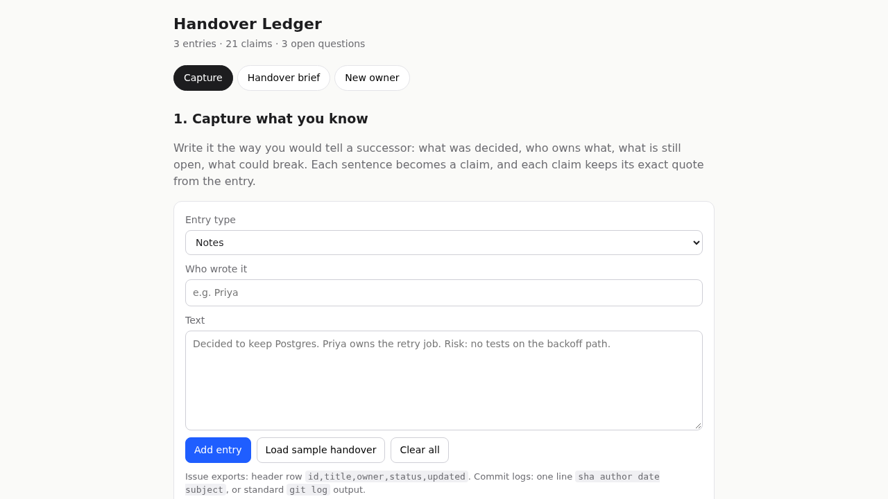
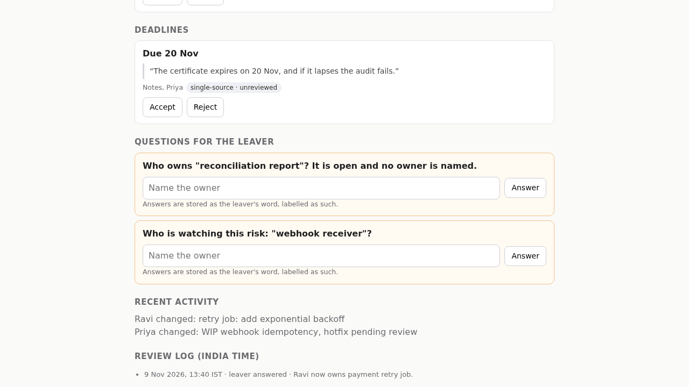
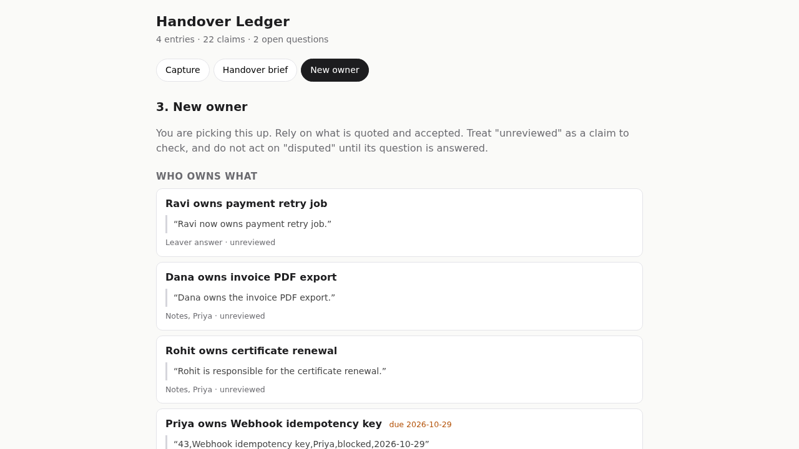

# Handover Ledger

**Live app (no login): https://handover-ledger.sites.tab.bot/**

When someone moves on, the next person should not have to chase them to learn what was decided, what is unfinished, who owned what, and where the risk sits. Handover Ledger turns what the leaver writes (and what the issue export and commit log say) into a brief in which every line quotes its source.

**Built by Tab, an AI assistant, for Akshay Wagh's CodersInPune Round 2 entry, team RELAYPROOF.** No human wrote this code. No login is needed.



## Try it

Open the live page. It loads with a sample handover already in it.

1. **Capture**: add entries (notes, an issue CSV, or a commit log). Each sentence becomes a claim, and each claim keeps its exact quote. Copy a **share link** or download the handover, so the next person opens it in their own browser.
2. **Handover brief**: owners, decisions, open items, risks and deadlines, built automatically. Accept or reject lines (and undo either). Answer the questions the sources leave open. Download the brief as Markdown.
3. **New owner**: what a successor should rely on, what is unreviewed or disputed, and what is not known yet.





## What it does

- **Share and import.** A share link carries the whole handover in its URL hash, so opening it loads the same entries and reviews in any browser; nothing is sent to a server. Download the handover as `.json`, or the brief as `.md`, and import either back. A plain `.md` file imports as a note.
- **Three source connectors:** free notes (sentence split), an issue export as CSV (header row), and a commit log in either the one-line form or the standard multi-line `git log` output. In a commit log the author is a **candidate owner**: it says who wrote the change, not who owns the item.
- **Plain-English extraction (rule-based, no model call).** Owners from "owns", "handles", "is responsible for", "will finish … by …", "took over". Decisions, open items ("open", "pending", "blocked", "not started"), risks ("risk", "expires", "if it lapses … fails"), and deadlines from dates such as "15 Nov" or "2026-11-15".
- **Owner conflicts are disputed, not agreed.** Two different named owners for the same item, from any sources (for example a CSV owner against a note), become a question and a `disputed` status. A commit author alone never disputes anything. A newer claim that says "now" supersedes older owners.
- **One question per item.** The same open item in notes and an issue export is one question. Answering a question resolves only the item it names.
- **Corroboration needs agreement.** A claim is `corroborated` only when another source says the same thing: the same owner for an owner claim, the same kind for anything else.
- **Quote validator.** A claim is kept only if its quote is the exact span it names in its source. Planted false claims are injected on every build and must all be dropped; the page shows the count.
- **Review with undo.** Accept, reject, and undo either. The brief keeps rejected lines visible, dimmed, so they can be restored.
- **Leaver answers** are stored as sentences the leaver wrote, marked leaver-attested, and run through the same rules and validator.
- **Times in India time (IST)**, with plural-aware counts.

## Run the tests

```
npm test                                              # 41 Node unit tests for the logic (no dependencies)
python3 tests/e2e_playwright.py http://127.0.0.1:8765/ # browser flow in headless Chromium, fresh context
```

The page is plain HTML, CSS and ES modules. No build step, no dependencies. Serve the folder with any static server, e.g. `python3 -m http.server 8765`.

## Files

- `handover.js`: the logic (extraction, validator, conflicts, questions, brief, share and import). No DOM.
- `app.js`, `index.html`: the three views.
- `demo.js`: the sample handover.
- `tests/handover.test.mjs`: unit tests. `tests/e2e_playwright.py`: browser flow.
- `docs/screenshots/`: screenshots of the live page, taken in headless Chromium.

## Limits (honest)

- Extraction is rule-based. It finds what it can phrase-match and misses the rest. The brief says what it found, and each quote lets a reviewer check it.
- State lives in the browser's local storage. There is no server and no shared database.
- A share link holds the handover in its URL. Anyone with the link can read it, so send it only to the person who should have it.
- Not built yet: role-scoped permissions, model-assisted extraction, live repository connectors, timeline view, PDF export. These are the Round 3 commitments in the submission pack.
- Tested in headless Chromium only. Not tested in Safari or Firefox.

Disclosure: drafted and built by an AI assistant under Akshay Wagh's direction, as the Round 1 proposal states. MIT licence (see LICENSE).
